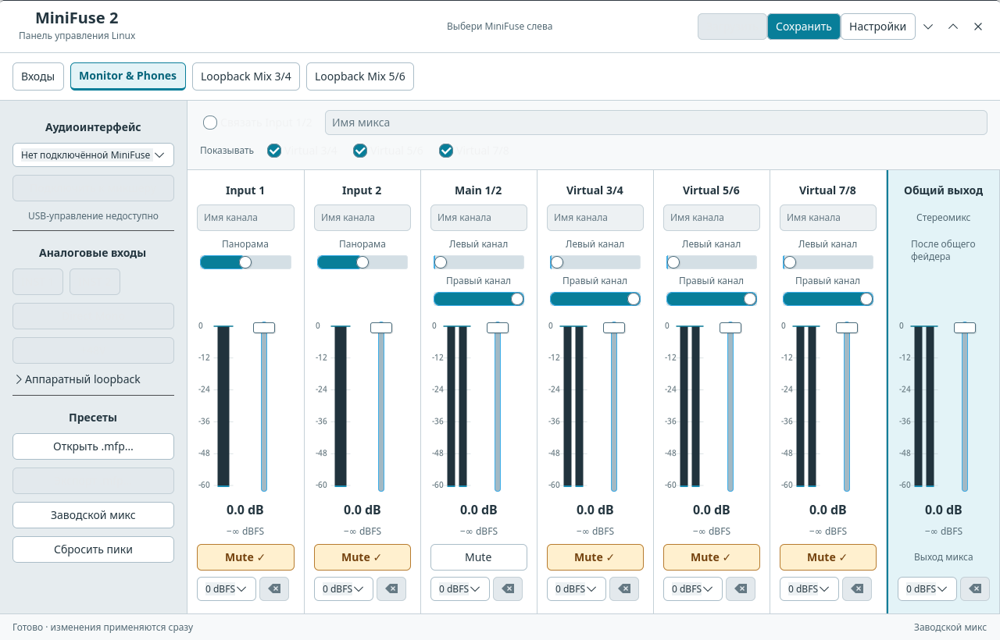

# MiniFuse 2 for Linux

**I made in with AI, for my personal use at first**

An independent control application for the **Arturia MiniFuse 2**: a native
GTK 4 desktop, a C audio/control service, and a bounded kernel control module.
The desktop does not require a browser or Python. Closing its window keeps
the audio service running.

[Инструкция по-русски](README.ru.md)

**Status: 0.1.0 preview.** Tested on one MiniFuse 2 with firmware 1.5.0,
CachyOS x86_64, PipeWire 1.6.9 and kernel 7.3.0-2-cachyos. Other distributions
and future kernels require testing. This is not an Arturia product.
The current desktop interface is in Russian.



## Features

- INST 1/2, Direct Mono, shared +48V and three hardware loopback switches,
  with capability checks and readback through `/dev/minifuze2ctl`.
- Three software stereo mixes; gain, pan, mute and master level.
- Four stereo playback endpoints and four recording endpoints in PipeWire.
- Hardware input VU and software meters, peak/clip preferences and PeakRef.
- Linux presets, unsaved working-mix recovery, Windows `.mfp` import/export,
  names, linked analog strips and virtual-strip visibility.
- Rate/buffer selection with actual-mode verification and Auto fallback.
  Forced settings affect the shared PipeWire server; manual changes are refused
  while another physical audio device is active.
- Light/dark desktop themes, switched instantly in Settings → Appearance.
  The choice is saved in `$XDG_CONFIG_HOME/minifuze2/desktop.ini` separately
  from audio and preset settings.
- A local web panel remains available as a fallback.

Firmware updating and real MIDI DIN transfer are **not implemented/tested**.
See [TODO.md](TODO.md) for the exact release boundaries. Standard USB audio
and MIDI enumeration are provided by Linux ALSA, not a replacement audio driver.

## Platform compatibility

| Target | Status |
| --- | --- |
| CachyOS, x86_64, kernel 7.3.0-2-cachyos, PipeWire 1.6.9, MiniFuse 2 firmware 1.5.0 | Built and tested on one physical interface |
| Ubuntu 24.04 | Ubuntu CI build and isolated software tests are configured; first GitHub run pending, no physical MiniFuse qualification |
| Other Linux distributions | Expected to work with the dependencies below, but hardware, installer and kernel-module behavior still need testing on each distribution |
| Windows and macOS | Not supported |

GTK itself is available on [Windows and macOS](https://docs.gtk.org/gtk4/), but
this application's audio engine and device handling depend on Linux
[PipeWire](https://pipewire.org/)/ALSA, Linux device interfaces, and an
optional Linux kernel module built using the target kernel's headers
([kernel module documentation](https://docs.kernel.org/kbuild/modules.html)).
The installer also uses systemd user services and udev. Porting the window
alone would not make the application work on another operating system. The
source can be rebuilt for another Linux distribution; the included binaries
are specific to the Linux system where they were built.

## Build

Requires a C11 compiler, make, pkg-config, GTK **4.12+**, libsoup **3.0+**,
json-c, libmicrohttpd and OpenSSL. Runtime needs PipeWire tools and WirePlumber.
No Python is used by the application; Python 3 is only needed for development tests.

Arch/CachyOS build dependencies:

```sh
sudo pacman -S --needed base-devel pkgconf gtk4 libsoup3 json-c libmicrohttpd openssl pipewire wireplumber
make -j2
```

On Debian/Ubuntu the development package names include `libgtk-4-dev`,
`libsoup-3.0-dev`, `libjson-c-dev`, `libmicrohttpd-dev`, and `libssl-dev`.
Use a distribution providing GTK 4.12 or later. Builds on these distributions
are covered separately from hardware qualification.

## Desktop installation

```sh
bash tools/install_desktop.sh
```

Run as your desktop user, without sudo. The installer adds binaries, an icon,
an application-menu entry and a user service. It enables the service for future
logins; the desktop starts it on demand. It refuses to overwrite existing files.
On first launch select the MiniFuse in the device list and connect it to the mixer.
The service retains the selected device in its working state.

If you already run the earlier research panel, use
`bash tools/install_desktop.sh --reuse-existing` to attach the desktop to it
without starting a second audio graph. An optional `--ready-file /absolute/path`
lets it follow that service's local address. This is a migration aid, not a
permanent conversion of the earlier service.

The engine listens only on `http://127.0.0.1:39713`. Desktop controls communicate
with it locally, including Host/Origin checks and a per-process CSRF token.
There is no telemetry. The service and desktop are separate processes.

User state: `${XDG_STATE_HOME:-$HOME/.local/state}/minifuze2/`.
Closing the desktop leaves the engine active. To stop audio mixing explicitly:

```sh
systemctl --user stop minifuze2.service
```

Uninstall application files with `bash tools/install_desktop.sh --uninstall`.
Presets and the kernel module are retained. The installer verifies its file
manifest before removing files. See [docs/installation.md](docs/installation.md)
for the separate kernel-module setup and removal.

## Development

See [CONTRIBUTING.md](CONTRIBUTING.md) for bug reports, validation and release
preparation, and [CHANGELOG.md](CHANGELOG.md) for preview changes.

```sh
make check
make build/desktop-smoke
python3 tools/test_desktop.py
```

The GTK integration test needs a graphical display and PipeWire. It creates
an isolated graph, refuses physical routes, tests actual GTK signals and the
HTTP client, and leaves the user's mixer alone. It also verifies the engine
continues after the test window closes. On a headless host use Xvfb.

The C engine and GTK client are in `native/app/` and `native/desktop/`.
`web/` is the embedded fallback UI. `kernel/` contains only the bounded control
module and its ABI. There is no vendor firmware or Windows installer here.

## Research and credits

Protocol investigation started from [nolight132/mf-cli](https://github.com/nolight132/mf-cli).
Mixer behavior was compared with the Windows Control Center, retained numeric
vectors and reversible Linux hardware experiments. Read the
[research account](docs/reverse-engineering.md) for observations, experiments
and limits of the results. This source tree excludes personal captures and
machine-specific settings. See [NOTICE.md](NOTICE.md) for attribution and licenses.

Local source archive: `bash tools/package_release.sh`. Add `--binary` to include
the two executables built for the current Linux system. Archives carry checksums;
their binaries use system libraries and are not universal Linux packages.
Neither command publishes anything to GitHub.
