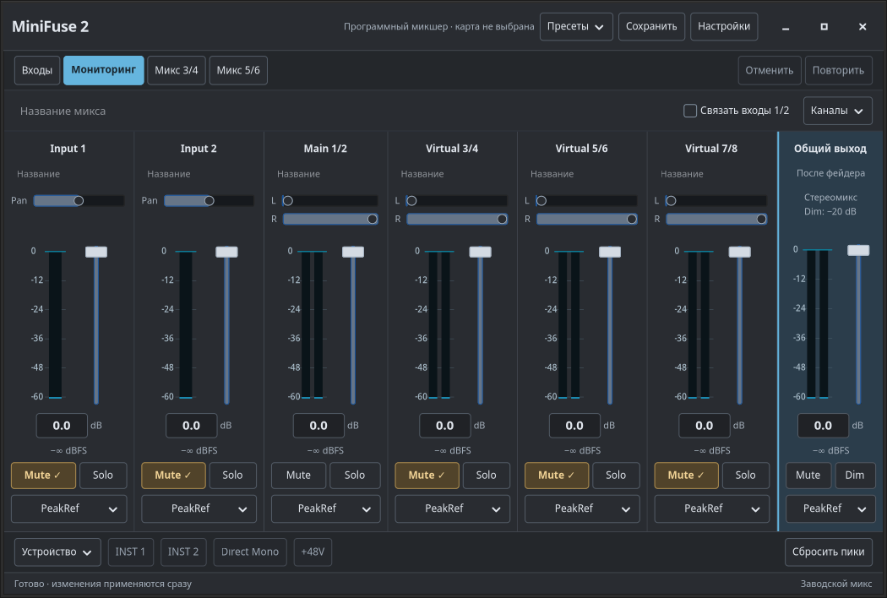

# MiniFuse 2 for Linux

[Releases and downloads](https://github.com/Potato83/MiniFuze-for-Linux/releases)
— source and Ubuntu 24.04 x86_64 archives with SHA256 checksums.

**I made in with AI, for my personal use at first**

An independent control application for the **Arturia MiniFuse 2**: a native
GTK 4 desktop, a C audio/control service, and a bounded kernel control module.
The desktop does not require a browser or Python. Closing its window keeps
the audio service running.

[Инструкция по-русски](README.ru.md)

**Version: 0.1.0.** Tested on one MiniFuse 2 with firmware 1.5.0,
CachyOS x86_64 and kernel 7.3.1-1-cachyos. Other distributions
and future kernels require testing. This is not an Arturia product.
The physically qualified audio mode is **48 kHz with automatic rate/buffer
settings**. Other rates and small buffers remain unqualified.
The current desktop interface is in Russian. The new studio features have local
software and isolated GTK coverage. Physical checks include loopback measurements,
same-port USB reconnect, port changes with serial-based control selection,
mixer recovery after a host PipeWire restart and suspend/resume,
headphone listening, microphone monitoring and a short
Ardour 9.8 playback/recording session at 48 kHz. Broader hardware qualification
remains pending; see [hardware acceptance](docs/hardware-validation.md) and
[release notes](docs/release-notes.md).



## Features

- INST 1/2, Direct Mono, shared +48V and three hardware loopback switches,
  with capability checks and readback through `/dev/minifuze2ctl`.
- Three software stereo mixes; gain, independent left/right pan, Mute and master level.
- Solo per source, master Mute and Dim (−20 dB), precise numeric gain entry and double-click reset.
- Undo/Redo for 32 software changes; Ctrl+Z, Ctrl+Shift+Z, Ctrl+S and Ctrl+O.
- Portable Linux `.json` presets. Names, input Link and virtual-strip visibility work without a Windows `.mfp` import.
- Four stereo playback endpoints and four recording endpoints in PipeWire.
- Hardware input VU and software meters, peak/clip preferences and PeakRef.
- Linux presets, unsaved working-mix recovery, Windows `.mfp` import/export,
  names, linked analog strips and virtual-strip visibility.
- Rate/buffer selection with actual-mode verification and Auto fallback.
  Forced settings affect the shared PipeWire server; manual changes are refused
  while another physical audio device is active.
- Compact dark studio desktop by default; light/dark themes switch instantly in Settings → Appearance.
  The choice is saved in `$XDG_CONFIG_HOME/minifuze2/desktop.ini` separately
  from audio and preset settings.
- A local web panel remains available as a fallback.

Firmware updating and real MIDI DIN transfer are **not implemented/tested**.
See [TODO.md](TODO.md) for the exact release boundaries. Standard USB audio
and MIDI enumeration are provided by Linux ALSA, not a replacement audio driver.

## Platform compatibility

| Target | Status |
| --- | --- |
| CachyOS, x86_64, kernel 7.3.1-1-cachyos, PipeWire 1.6.10/1.6.11, MiniFuse 2 firmware 1.5.0 | Candidate built and measured on one physical interface |
| Ubuntu 24.04 | CI build, isolated software/GTK tests and kernel compilation passed; no physical MiniFuse qualification |
| Other Linux distributions | Expected to work with the dependencies below, but hardware, installer and kernel-module behavior still need testing on each distribution |
| Windows and macOS | Not supported |

GTK itself is available on [Windows and macOS](https://docs.gtk.org/gtk4/), but
this application's audio engine and device handling depend on Linux
[PipeWire](https://pipewire.org/)/ALSA, Linux device interfaces, and an
optional Linux kernel module built using the target kernel's headers
([kernel module documentation](https://docs.kernel.org/kbuild/modules.html)).
The installer also uses systemd user services and udev. Porting the window
alone would not make the application work on another operating system. The
source can be rebuilt for another Linux distribution; the included binaries
are specific to the Linux system where they were built.

## Build

Requires a C11 compiler, make, pkg-config, GTK **4.12+**, libsoup **3.0+**,
json-c, libmicrohttpd and OpenSSL. Runtime needs PipeWire tools and WirePlumber.
No Python is used by the application; Python 3 is only needed for development tests.

Arch/CachyOS build dependencies:

```sh
sudo pacman -S --needed base-devel pkgconf gtk4 libsoup3 json-c libmicrohttpd openssl pipewire wireplumber
make -j2
```

On Debian/Ubuntu the development package names include `libgtk-4-dev`,
`libsoup-3.0-dev`, `libjson-c-dev`, `libmicrohttpd-dev`, and `libssl-dev`.
Use a distribution providing GTK 4.12 or later. Builds on these distributions
are covered separately from hardware qualification.

## Desktop installation

```sh
bash tools/install_desktop.sh
```

Run as your desktop user, without sudo. The installer adds binaries, an icon,
an application-menu entry and a user service. It enables the service for future
logins; the desktop starts it on demand. It refuses to overwrite existing files.
On first launch select the MiniFuse in the device list and connect it to the mixer.
The service retains the selected device in its working state.

If you already run the earlier research panel, use
`bash tools/install_desktop.sh --reuse-existing` to attach the desktop to it
without starting a second audio graph. An optional `--ready-file /absolute/path`
lets it follow that service's local address. This is a migration aid, not a
permanent conversion of the earlier service.

The engine listens only on `http://127.0.0.1:39713`. Desktop controls communicate
with it locally, including Host/Origin checks and a per-process CSRF token.
There is no telemetry. The service and desktop are separate processes.

User state: `${XDG_STATE_HOME:-$HOME/.local/state}/minifuze2/`.
Closing the desktop leaves the engine active. To stop audio mixing explicitly:

```sh
systemctl --user stop minifuze2.service
```

Uninstall application files with `bash tools/install_desktop.sh --uninstall`.
Presets and the kernel module are retained. Update an existing managed installation
with `bash tools/install_desktop.sh --update` after closing its window. It updates
owned application files, retains the installed service configuration, and restores
previous files if an update command fails. An active owned service briefly stops
and restarts. Reopen the desktop afterwards.
The installer verifies its file
manifest before removing files. See [docs/installation.md](docs/installation.md)
for the separate kernel-module setup and removal.

## Development

See [CONTRIBUTING.md](CONTRIBUTING.md) for bug reports, validation and release
preparation, and [CHANGELOG.md](CHANGELOG.md) for changes.

```sh
make check
make build/desktop-smoke
dbus-run-session -- env MINIFUZE_RUNTIME_TESTS=1 make check
python3 tools/test_desktop.py
```

The GTK integration test needs a graphical display and PipeWire. It creates
an isolated graph, refuses physical routes, tests actual GTK signals and the
HTTP client, and leaves the user's mixer alone. It also verifies the engine
continues after the test window closes. On a headless host use Xvfb.

The C engine and GTK client are in `native/app/` and `native/desktop/`.
`web/` is the embedded fallback UI. `kernel/` contains only the bounded control
module and its ABI. There is no vendor firmware or Windows installer here.

## Research and credits

Protocol investigation started from [nolight132/mf-cli](https://github.com/nolight132/mf-cli).
Mixer behavior was compared with the Windows Control Center, retained numeric
vectors and reversible Linux hardware experiments. Read the
[research account](docs/reverse-engineering.md) for observations, experiments
and limits of the results. This source tree excludes personal captures and
machine-specific settings. See [NOTICE.md](NOTICE.md) for attribution and licenses.

Local source archive: `bash tools/package_release.sh` from a clean Git checkout.
Packaging uses Python 3; the application does not. Add `--binary` to include
the two executables built for the current Linux system. Archives carry checksums;
their binaries use system libraries and are not universal Linux packages.
Neither command publishes anything to GitHub. Only tracked source files are
included; `BUILD-INFO.json` records the source commit. Verify complete archives
with `python3 tools/release.py verify dist/minifuze2-0.1.0-*.tar.gz`.

Studio controls and file compatibility are described in [the desktop guide](docs/desktop-design.md).
The candidate also passed a 48 kHz physical loopback, same-port USB reconnect
and real user-service update on CachyOS; see [hardware acceptance](docs/hardware-validation.md).
New files use Linux document version 4; the application reads earlier versions 1–3.
Keep backups before switching back to an older application, which cannot read the new format.
Linux presets include Solo/Dim/master Mute; Windows `.mfp` export requires turning
these controls off and retaining an imported Windows template. Hardware switches,
device selection and global rate/buffer settings are not included in exported presets.

A `vVERSION` tag triggers the checked [release workflow](.github/workflows/release.yml)
after application, isolated GTK, archive and kernel build jobs pass. Candidate
versions produce prereleases; stable versions produce a draft for final review.
See [release notes](docs/release-notes.md), the [release process](docs/releasing.md)
and remaining qualification in [TODO.md](TODO.md).
