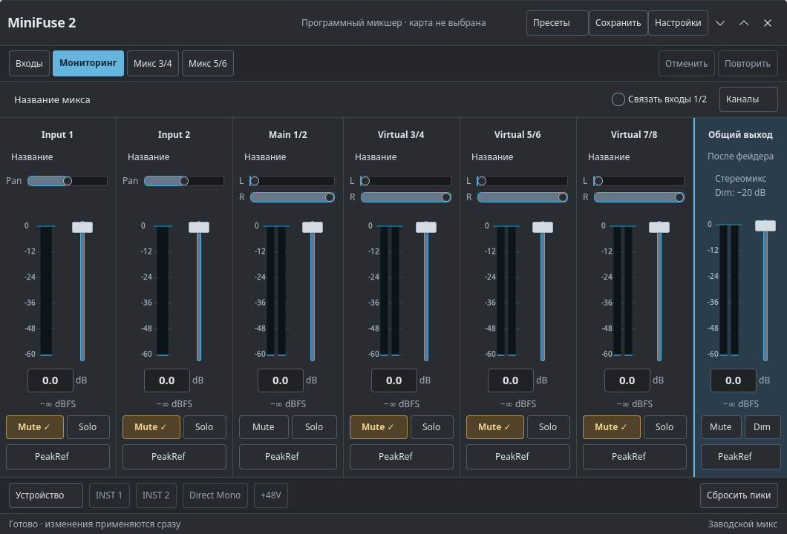
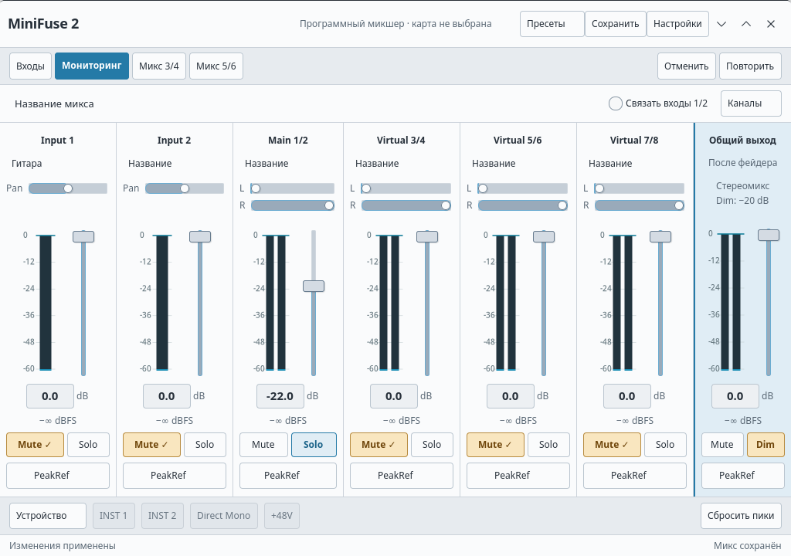

# Студийный микшер

Настольная панель на C/GTK 4 открывается как компактный тёмный микшер.
Основное окно рассчитано на размер около 1060 × 700 px. Общий выход закреплён
справа, а входные полосы при нехватке места прокручиваются по горизонтали.
Закрытие окна оставляет аудиослужбу и звук работающими.

Скриншоты показывают разрабатываемую версию в изолированном тестовом сеансе.

## Компоновка

В заголовке находятся состояние подключения, меню пресетов, сохранение и
настройки. Следующая строка переключает входные индикаторы и три микса:
мониторинг, Mix 3/4 и Mix 5/6. Здесь же расположены отмена и повтор.
Имя выбранного микса, связь Input 1/2 и меню видимости виртуальных каналов
занимают отдельную компактную строку.

Полосы следуют порядку MiniFuse: Input 1, Input 2, Main 1/2 и три виртуальные
пары. Каждая полоса содержит имя, панораму, индикатор, фейдер, точное значение
уровня, Mute, Solo и меню PeakRef. У стереоисточников сохранены отдельные
панорамы L/R. Общий выход содержит собственные Mute и Dim −20 dB.

Аппаратные переключатели INST, Direct Mono и +48V находятся внизу окна.
Меню «Устройство» содержит выбор карты, подключение к микшеру и аппаратные
маршруты loopback. Частота, буфер, поведение индикаторов и тема находятся
в настройках. Изменение частоты и буфера предваряется предупреждением
о кратком прерывании звука.

## Палитра и типографика

Тёмная палитра определена в `native/desktop/dark.css`, общая геометрия и
светлая палитра — в `native/desktop/style.css`.

| Роль | Тёмная студия | Светлая студия |
| --- | --- | --- |
| Фон | `#202226` | `#edf0f3` |
| Поверхность полос | `#292c31` | `#fafbfc` |
| Основной текст | `#e1e6ed` | `#27303a` |
| Вторичный текст | `#a8b3bf` | `#596774` |
| Разделители | `#41464e` | `#cbd2da` |
| Акцент | `#65b5de` | `#247aa7` |

Голубой акцент обозначает выбранный микс, Solo и общий выход. Активный Mute
имеет янтарную заливку, явную отметку и более плотную надпись. Красный
используется для ошибок и +48V. Состояние не передаётся одним цветом.

Шрифт — Noto Sans с системным запасным sans-serif. Основной размер — 13 px,
название приложения — 18 px, числовой уровень — 15 px. Для уровней используются
табличные цифры. Небольшие отступы и выровненные органы управления оставляют
больше места индикаторам и фейдерам.

## Управление

Уровень задаётся фейдером с шагом 0,1 dB или числом от −60 до 0 dB с
подтверждением по Enter. Двойной щелчок по фейдеру возвращает 0 dB,
по панораме — исходное положение канала. Mute имеет приоритет над Solo;
несколько Solo работают одновременно в выбранном миксе. Dim ослабляет
общий выход на 20 dB, сохраняя значение его фейдера.

Ctrl+Z и Ctrl+Shift+Z отменяют и повторяют последние 32 программных изменения.
Аппаратные переключатели, подключение карты, частота и буфер в историю не
входят. В активном текстовом поле сохраняется обычная работа с текстом.
Ctrl+S сохраняет микс, Ctrl+O открывает пресет. Имена применяются по Enter.

Имена, связь входов, видимость виртуальных полос и PeakRef доступны без
импортированного Windows-пресета. Linux-файлы `.json` сохраняют три микса
и их оформление; для экспорта `.mfp` нужен исходный Windows-шаблон.
Solo, Dim и Mute общего выхода перед экспортом `.mfp` нужно выключить.

## Состояния и доступность

Фейдеры, панорамы и PeakRef имеют имена для экранного диктора с указанием
канала. Клавиатурный фокус видим; недоступные элементы остаются читаемыми.
Отсутствующая частота обозначается текстом. Полосы источников показывают
уровень до фейдера, общий выход — после программного микширования.
Его фейдер не управляет физической ручкой громкости MiniFuse.

При потере связи с аудиослужбой окно сохраняет черновик микса и повторяет
его отправку после восстановления связи. Отвергнутый некорректный микс
не отправляется бесконечно. Аппаратные команды после сбоя не повторяются.
Новые возможности отключаются при подключении к старому движку, который
их не поддерживает.

## Выбор темы

«Настройки → Оформление → Тема» переключает «Тёмную студию» и «Светлую
студию» сразу, без перезапуска аудиослужбы. Геометрия окна общая, цвета
индикаторов меняются вместе с темой. Выбор атомарно сохраняется в
`$XDG_CONFIG_HOME/minifuze2/desktop.ini` и читается при запуске.
На новой установке используется тёмная тема; существующий выбор сохраняется.

В разрабатываемой версии «Настройки → Оформление → Язык» предлагает системный
язык, русский и английский. Выбор сохраняется в том же файле и применяется
после закрытия и повторного открытия окна; аудиослужбу перезапускать не нужно.
Если системный язык отличается от русского, используется английский. Диалоги
выбора файлов и подробные сообщения системы могут оставаться на языке системы.

